<div align="center">

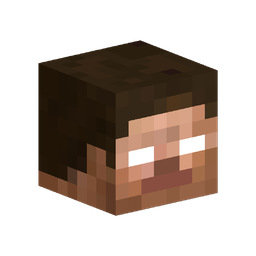

# Herobrine: The Myth

**Bringing the old Herobrine back.**  
*He was never removed.*

A Forge 1.20.1 horror mod that brings back the classic Herobrine from the old mods and plugins, with slow psychological horror on top.

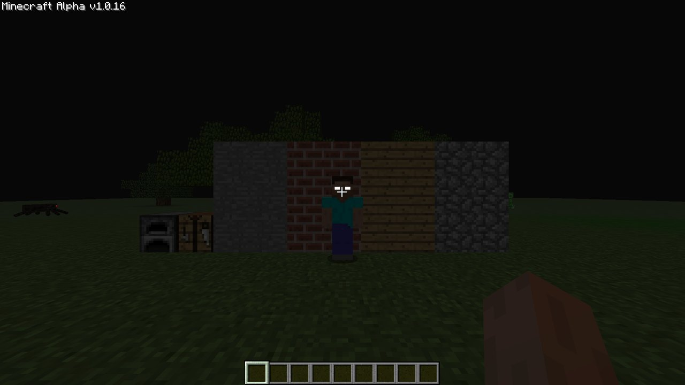

`Minecraft 1.20.1` · `Forge 47.x` · `Beta`

</div>

---

## What is this?

Modern Herobrine mods usually turn him into a monster that builds a few things and stares. This mod goes back to how the old Herobrine felt: you are never sure he is there, until he is. It only uses things that already exist in Minecraft: Steve's skin, vanilla sounds, vanilla mobs and vanilla blocks.

**Inspired by** the original creepypasta and the classic mods and plugins. Their behaviour was studied from their source code and recreated from scratch:

- **iLoveYou**, the first Herobrine plugin (CanaryMod, by tkelly, Talmor and darkdiplomat).
- **HerobrineAI** (by Jakub1221).
- **BasicHerobrine** (by steaks4uce).
- **Herobrine Unleashed**.

## How he acts

It is a **slow burn**. On day one almost nothing happens: a cave sound you are not sure you heard, footsteps that stop when you turn around. Every Minecraft day there is a little more, and new things become possible, until around day 30 he can do everything. That makes it fit a 100-day run.

- **Only you see him.** The friend standing next to you sees nothing.
- **Most of what he does makes no sound.** What you do hear is very quiet: a "pss...", glass breaking far away, a horse dying somewhere.
- **The sounds have someone behind them.** Footsteps, mining, building and knocking all stop the instant you look where they come from.
- **The game is old and quiet again.** The world's own sounds are muted. What he causes is not. Cave sounds play slowed down with a long echo.
- **The sky is always overcast**, grey by day and black by night. Sometimes blood rains and night falls at once.
- **You choose the pace** when you create a world: he gets stronger every N days or every N minutes.
- **He prefers the night**, and the world is almost empty: very few animals and very few monsters.
- **Hit an animal and it may become his.** A ghast screams, and its eyes are white now.
- **Animals that stare.** Some stop and follow you with their heads. Some only stare while your back is turned. Some say "pss..." as you walk past.
- **Someone else was here:** a pillar of cobblestone, a tree chopped halfway, a crafting table and a furnace in a field, a staircase going down.
- **Don't break his things.** Lightning, him, his mobs, lava, a deep cave. "Don't do that again..."
- **Blood moon:** some nights are one night of chaos.
- **Every rain is red.**

| | |
|:-:|:-:|
| 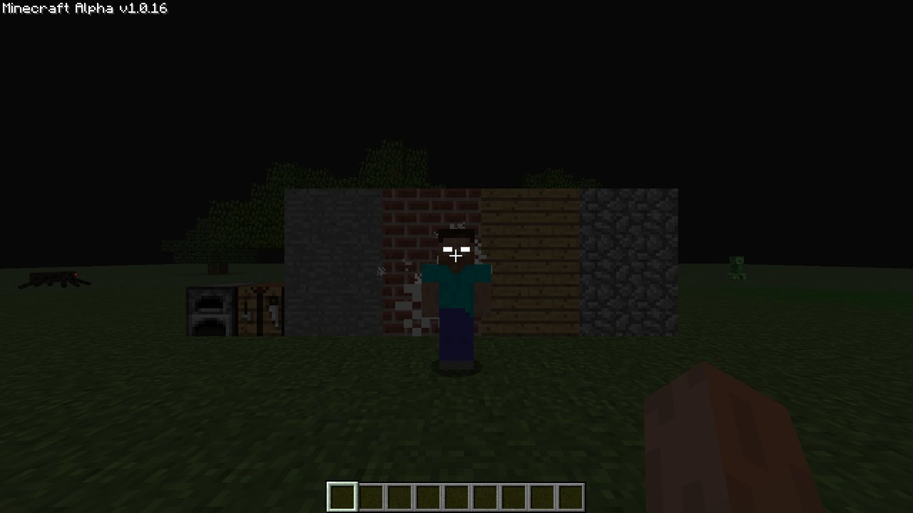 | 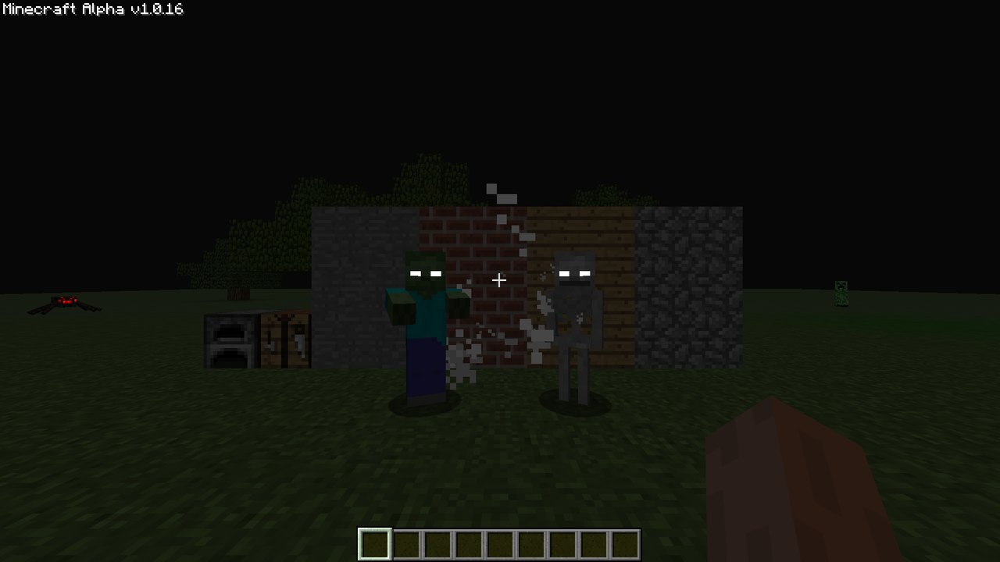 |
| **He watches.** From far away, behind trees, in the dark. Look too long and he is gone. | **Possessed mobs.** Vanilla mobs with his white eyes stare at you in silence, then all come at once. |
| 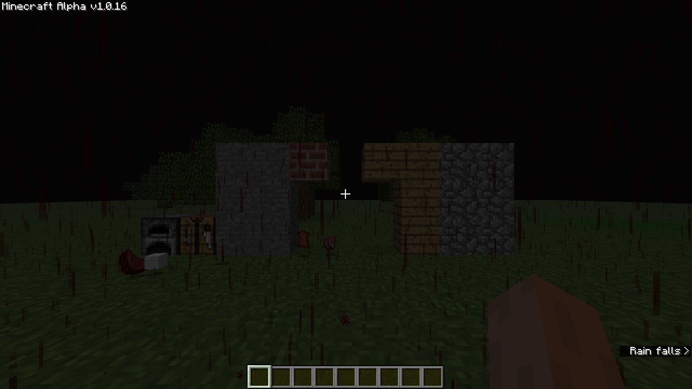 | 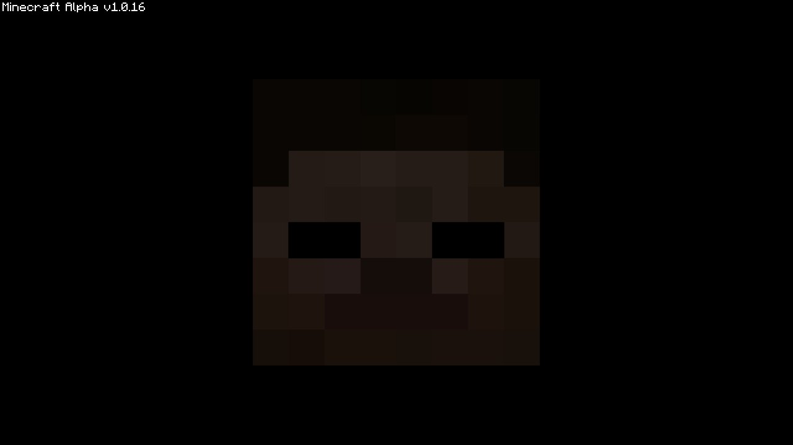 |
| **Blood rain.** Night falls at once. | **His face.** Rare, and never when you expect it. |
| 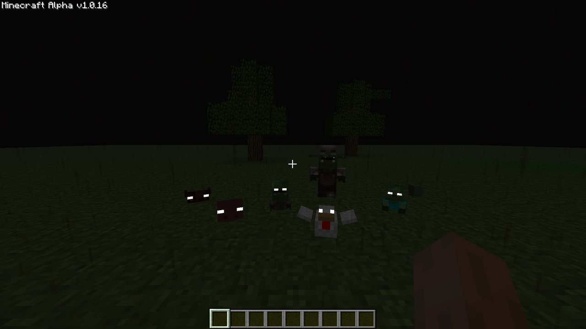 | 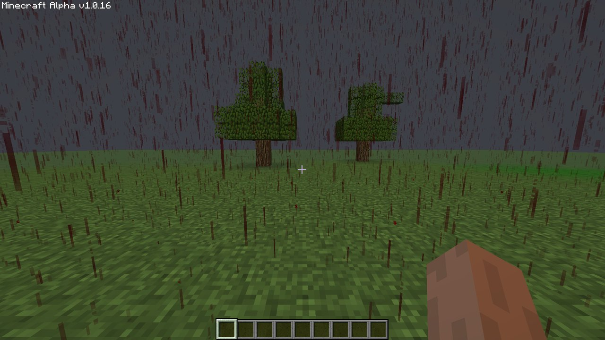 |
| **Nothing is safe.** Not even the chickens. | **Every rain is red.** |

**Haunting**
- Total silence: every sound in the game stops.
- Footsteps behind you, someone mining inside the walls, whispers in your ear.
- Record 11 playing nearby, then stopping mid-song.
- Doors and chests opening on their own.
- Fake chat: "Herobrine joined the game".
- Old-TV static.
- Breathing in your ear. Your name. Someone eating behind you. Music, as if something were chasing you.
- Things thrown at you from the dark. Notes that know your name, your day, your home.

**Appearances**
- Far away, right where you are looking, for two seconds.
- Behind the trees, in your doorway, on the roof, closer and closer behind you.
- A plain Steve in the dark of a cave, taking small steps towards you.
- He only moves when you are not looking.
- He chases you.
- He takes control of your body.
- He drags you into an empty cave.
- Villagers, cows, pigs or chickens come for you, out of nowhere.
- He throws you out to the title screen (your world is saved first).

**Classic behaviours**
- The ghost with a redstone torch who vanishes when you step towards him.
- The thief standing on your chest.
- "I have something for you": he digs down to diamonds, you follow, and the way back closes behind you.
- Burying you alive.
- Commands that answer in garbage.

**Structures**
- Sand pyramids, leafless trees, perfect 2x2 tunnels.
- Crosses, fire, smiles, signs.
- Your grave.
- Redstone torches in caves.
- Ruined temples with his artifacts.

| | |
|:-:|:-:|
| 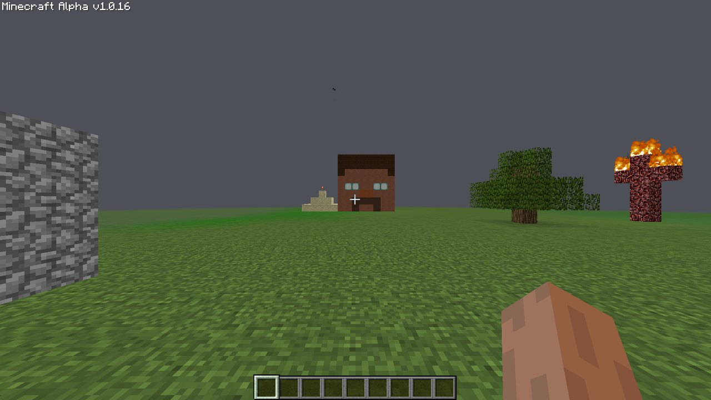 | 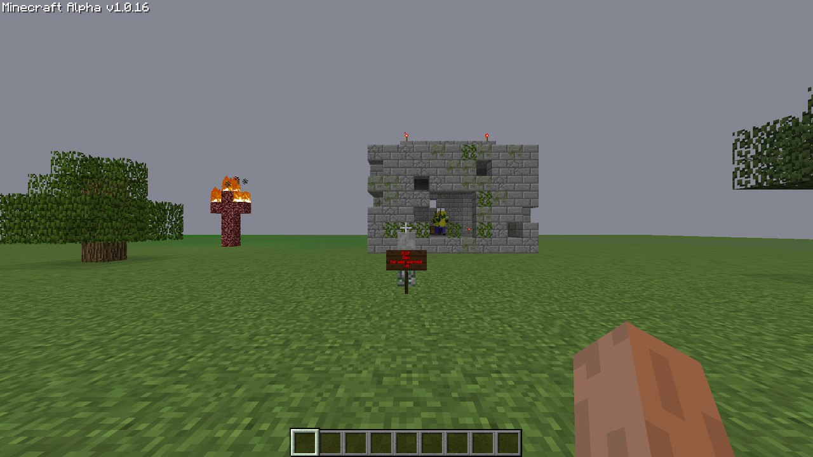 |
| 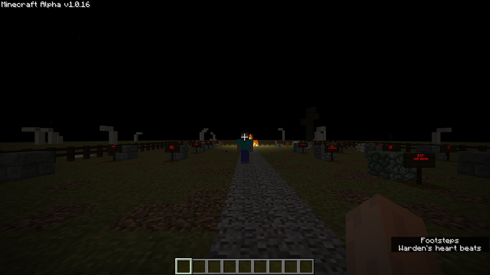 | 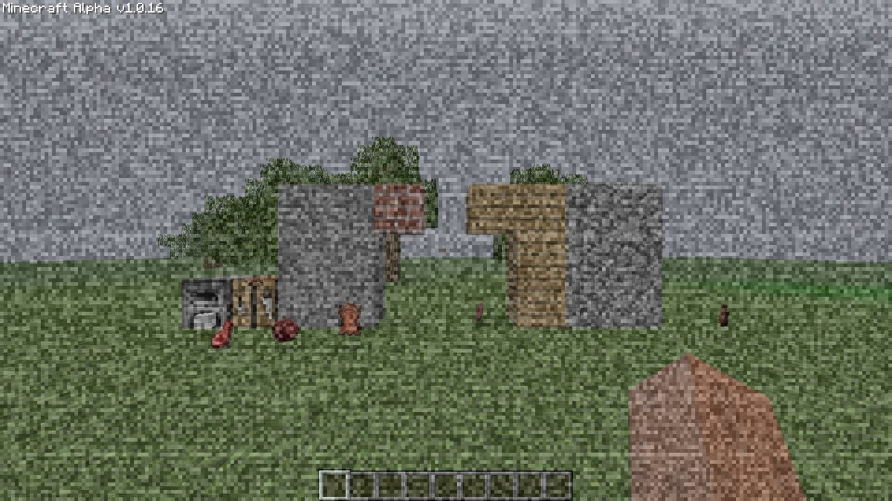 |
| **The Graveyard.** Sometimes you wake up somewhere else, and he walks down the path towards you. | **Static.** When something is wrong. |

## The Totem

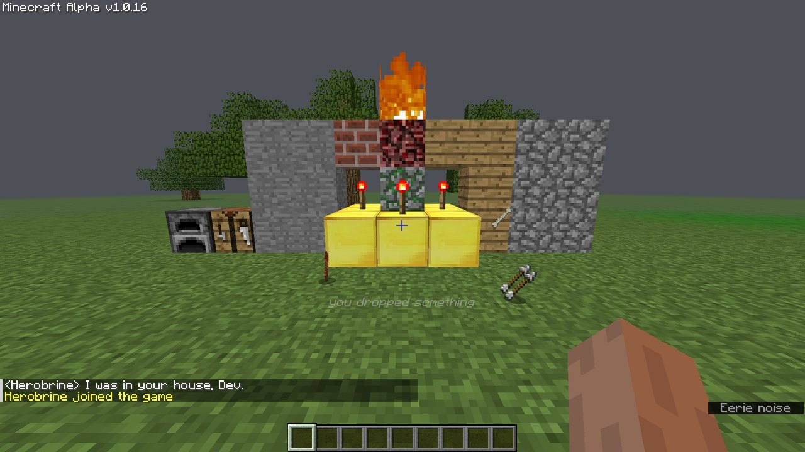

```
          fire
       netherrack
  [T] mossy cobblestone [T]      T = redstone torch on each of the 4 sides
     3x3 gold blocks
```

Light it with flint and steel. The other two classic altars work too: HerobrineAI's (3x3 gold, netherrack with 4 redstone torches around it) and BasicHerobrine's (mossy cobblestone with netherrack on top).

**After that, he never leaves.**
- Eternal night and storms. No sleeping.
- Events far more often.
- Swarms of possessed mobs.
- The world corrupts and whole chunks are eaten into the void.
- The game "crashes" (it always saves first).
- In the end, he takes the world.

| | |
|:-:|:-:|
| 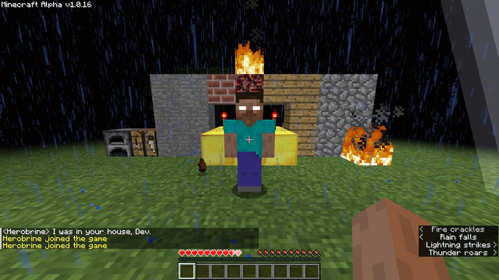 | 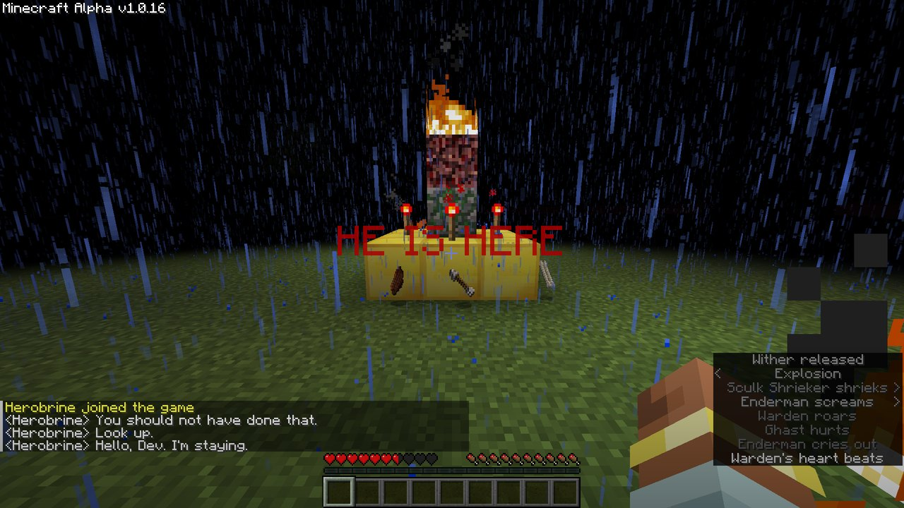 |
| 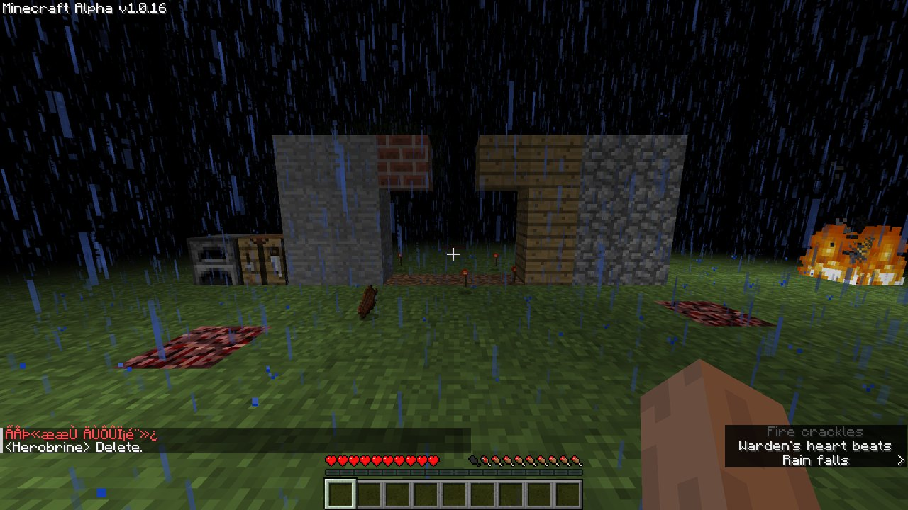 | 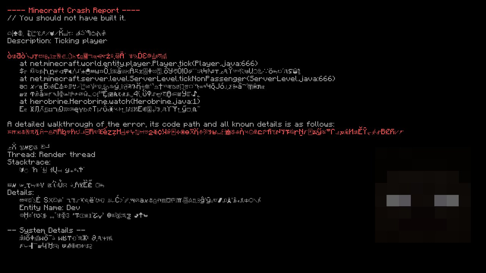 |

> By default "taking the world" only **hides** it: it moves to `.minecraft/herobrine_took_your_worlds/` and can be put back. Real deletion is opt-in in the config (`worldDeletionMode = "DELETE"`).

## The old look

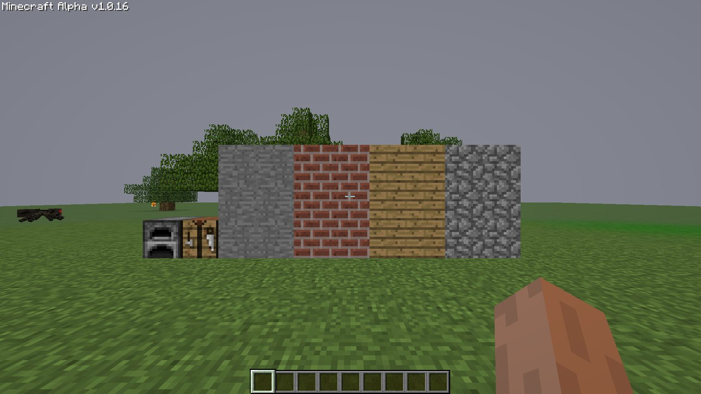

- **The real old textures.** On first launch the mod builds a resource pack from Minecraft Beta 1.8.1 and 1.7.10 on *your own computer*: from your launcher if you have them installed (official launcher, Prism, MultiMC), otherwise from Mojang's own download servers. Nothing from Mojang is shipped inside the mod.
- **The old lighting:** no smooth lighting, grey light.
- **The old "oof"** when you get hurt.
- Every player, and your own hand, is Steve.
- "Minecraft Alpha v1.0.16" sits in the corner of the screen.

All of this can be turned off in the config.

## Install

1. Install **Forge 1.20.1** (47.x).
2. Download the jar from [Releases](../../releases) and put it in your `mods` folder.
3. For multiplayer, the server **and** every player need the mod.

Config file: `config/herobrinemyth-common.toml`. You can set:
- **The pace:** a day scale and events per day (the speed itself is chosen per world when you create it).
- **What he may do:** break blocks, damage your house, kill you, burn, corrupt and eat chunks, each with its own starting day.
- **The totem and the ending:** what happens after the totem, and what "taking the world" does.
- **The atmosphere:** classic sounds, echo, overcast sky, red rain, old textures, old lighting and the old look.
- **1.4 extras:** blood moons, being thrown out, structure punishments, shared multiplayer events, small random damage, the totem bosses.

<details>
<summary>Commands (op)</summary>

| Command | What it does |
|---|---|
| `/herobrine trigger <event>` | Any event (press TAB for the list) |
| `/herobrine build <structure>` | Builds one of his structures |
| `/herobrine jumpscare` | Immediately |
| `/herobrine totem activate` / `reset` | Summon him / undo it |
| `/herobrine day <players> <day>` | Forces the day of the haunting (0 = automatic) |
| `/herobrine calm` | He backs off for a while |
| `/herobrine bloodmoon` | Tonight the moon is red |
| `/summon herobrinemyth:herobrine ~ ~ ~ {HBMode:"SHRINE",HBLife:600}` | Places him for videos |

</details>

## Building

```
./gradlew build             # jar in build/libs
./gradlew runClient         # play
./gradlew runGameTestServer # automated tests
```

Gradle needs Java 17 or 21 to run.

---

<details>
<summary><b>Português: Herobrine: A Lenda</b></summary>

O Herobrine clássico dos mods antigos está de volta, com terror psicológico lento: ele observa de longe, se esconde atrás das árvores, faz sons baixíssimos que param quando você olha, possui os animais, constrói e, depois do totem, nunca mais vai embora. Tudo usa só coisas do Minecraft (skin do Steve, sons, mobs e blocos vanilla).

As mecânicas foram recriadas estudando os originais: iLoveYou, HerobrineAI, BasicHerobrine e Herobrine Unleashed.

**Visual antigo:** na primeira vez que o jogo abre, o mod monta as texturas da Beta 1.8.1 e da 1.7.10 a partir dos arquivos do seu próprio launcher (ou dos servidores da Mojang), junto com a iluminação antiga.

**Totem:** 3x3 de ouro, pedra musgosa no centro, 4 tochas de redstone em volta dela e netherrack em cima. Acenda com isqueiro. Depois disso ele nunca mais vai embora.

**Instalação:** Forge 1.20.1, coloque o jar da aba Releases na pasta `mods`. No multiplayer, o servidor e todos os jogadores precisam do mod.

</details>

<div align="center">

Made by **hadrykkxd** · Not affiliated with Mojang or Microsoft

</div>
